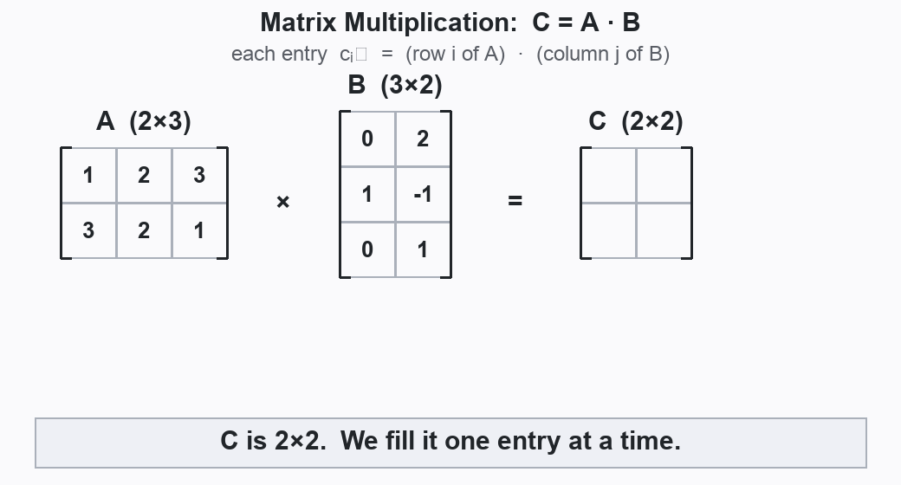

# Matrix

> **One-liner:** A matrix is a rectangular grid of numbers — and that grid can both *store a system of equations* and *act as a function that transforms vectors*.

## 🟢 Intuition (Dummy)
A matrix is just a table of numbers with rows and columns, like a spreadsheet. Why bother?
Two reasons. First, it's a tidy way to write down a whole [[system-of-linear-equations]] at once.
Second — and this is the deep part — a matrix is also a **machine**: feed it a [[vector]] and it
spits out a new vector ([[linear-mapping]]). So one grid of numbers does double duty: it *stores
data* and it *does things to data*. Keep straight which role a given matrix is playing.

## 🟡 Mechanics (Practitioner)
An $(m,n)$ matrix has $m$ rows and $n$ columns, $A \in \mathbb{R}^{m\times n}$, entries $a_{ij}$.

**Addition** (same shape, element-wise): $(A+B)_{ij} = a_{ij}+b_{ij}$.

**Multiplication** $C = AB$ with $A\in\mathbb{R}^{m\times n}, B\in\mathbb{R}^{n\times k}, C\in\mathbb{R}^{m\times k}$:
$$ c_{ij} = \sum_{l=1}^{n} a_{il}\,b_{lj} $$
Row $i$ of $A$ "dot" column $j$ of $B$. **Neighboring dimensions must match** ($n=n$); inner
dimension collapses, outer dimensions survive. ⚠️ Not commutative: $AB \neq BA$ in general
(Example 2.3: same $A,B$ give a $2\times2$ *and* a $3\times3$ result).

**Animation — each entry is a row · column dot product** (Example 2.3, $C = AB$):

The amber **row of $A$** times the blue **column of $B$** accumulates, term by term, into the
green **target cell of $C$** — repeated for all four entries. Regenerate with
`python3 assets/matrix-multiply-anim.py`.

**Identity** $I_n$: 1's on the diagonal, 0's elsewhere; $I_mA = AI_n = A$.

**Inverse** $A^{-1}$ (square only): the $B$ with $AB = I = BA$. Exists ⇔ $A$ is *regular /
invertible / nonsingular*; when it exists it is unique. For $2\times2$:
$$ A^{-1} = \frac{1}{a_{11}a_{22}-a_{12}a_{21}}\begin{bmatrix} a_{22} & -a_{12}\\ -a_{21} & a_{11}\end{bmatrix}, \quad \text{iff } a_{11}a_{22}-a_{12}a_{21}\neq 0 $$
(that denominator is the *determinant*, Ch. 4).

**Transpose** $A^\top$: $b_{ij}=a_{ji}$ (flip rows↔columns). **Symmetric** if $A=A^\top$ (square only).

**In ML:** weight matrices in neural nets, covariance matrices, data matrices (rows = samples).
⚠️ Element-wise product $c_{ij}=a_{ij}b_{ij}$ is the **Hadamard product**, *not* matrix multiplication.

## 🔴 Theory (Expert)
Key algebraic identities (all from §2.2.2):
$$ (AB)^{-1}=B^{-1}A^{-1}, \quad (AB)^\top = B^\top A^\top, \quad (A^\top)^\top = A, \quad (A+B)^\top = A^\top+B^\top $$
Note $(A+B)^{-1} \neq A^{-1}+B^{-1}$ in general. If $A$ invertible, so is $A^\top$, and $(A^{-1})^\top = (A^\top)^{-1} =: A^{-\top}$.

- Matrix multiplication is **associative** and **distributive** but not commutative.
- The set of invertible $n\times n$ matrices under multiplication forms the **general linear
  group** $GL(n,\mathbb{R})$ (Def 2.8) — a [[vector-space|group]] that is *not* Abelian.
- A matrix represents either a **collection of vectors** (columns) or a **[[linear-mapping]]**
  (via Def 2.19, a transformation matrix w.r.t. ordered bases). Same object, two readings.
- The product $A\mathbf{x}$ is a **linear combination of the columns of $A$** weighted by the
  entries of $\mathbf{x}$ — the bridge to [[linear-independence]] and [[basis-and-rank]].

## Connections
- Builds on: [[vector]], [[vector-space]]
- Leads to: [[gaussian-elimination]], [[linear-mapping]], [[basis-and-rank]]
- Used by: [[system-of-linear-equations]], all of ML (weights, covariances)
- People: —

## Sources
- `raw/mml-book.pdf` §2.2, Defs 2.1–2.5, printed pp. 22–26 (PDF pp. 27–31). Validated 2026-06-04.
