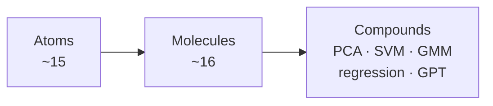

# Atoms, Molecules, Compounds

> **One-liner:** About 15 **atoms** bond into about 16 **molecules**, and every big ML method
> (PCA, SVM, GMM, regression, GPT) is a **compound** of those molecules — nothing else.
> Underneath them all sit **5 axioms** (validated as irreducible); the **8 working principles** are derived from them.

This page extends [[learning-path]] (which lists the atoms) with the two missing layers.

## How the layers were found

Every concept page lists its prerequisites under `Builds on:`. A script followed those links
across all 278 concept pages and counted, for each page, how many other pages depend on it
(directly or indirectly). This is the page's **downstream reach**.

- **Atom** = very high reach, and its own prerequisites are only other atoms (or nothing).
- **Molecule** = a small, named combination of 2–4 atoms, with one formula, reused by many methods.
- **Compound** = a full ML method or architecture built from several molecules.

Top reach (out of 277 possible): [[vector]] 276 · [[vector-space]] 264 · [[matrix]] 255 ·
[[linear-mapping]] 241 · [[norm]] 223 · [[inner-product]] 218 · [[derivative]] 198 ·
[[gradient]] 191 · [[random-variable]] 191 · [[probability-distribution]] 189 ·
[[chain-rule]] 167 · [[loss-function]] 165 · [[expected-value-and-mean]] 152.
[[vector]] is the only math page with no prerequisite at all.

---

## 🔬 Validation — are the 8 principles the most elemental? (2026-10-27)

**No.** The 8 principles are useful *working* rules, but 4 of them can be derived from the others.
The irreducible bottom is **5 axioms**. Test used: *a principle is elemental only if it cannot be
derived from the others.*

### The 5 axioms (truly irreducible)

| Axiom | Statement | Why it can't be derived from the others |
|---|---|---|
| **A. Linearity** | Vectors can be added and scaled; linear maps keep that: $f(ax+by)=af(x)+bf(y)$ | Base structure. Everything else is built on it. |
| **B. Inner product** | $\langle x,y\rangle$: symmetric, linear, $\langle x,x\rangle>0$ for $x\ne0$ | A vector space has no lengths or angles until you add one ([[inner-product]]). |
| **C. Local linearity** | $f(x+h)\approx f(x)+\nabla f(x)^\top h$ for small $h$ | Needs limits, which A and B do not give ([[derivative]], [[taylor-series]]). |
| **D. Probability rules** | $p\ge0$, total $=1$; **sum rule** $p(x)=\sum_y p(x,y)$; **product rule** $p(x,y)=p(y\mid x)p(x)$ | Kolmogorov axioms + definition of conditional probability. ([[mml-ch06-probability-and-distributions]] §6.3) |
| **E. Learning = optimization** | Choose $\theta$ to minimize a loss on the data ([[empirical-risk-minimization]] / [[maximum-likelihood-estimation]]) | A *modeling choice*, not a theorem. No math forces it; ML adopts it. |

Below the axioms is the **floor** of school math, assumed here: numbers, functions, $\sum$ notation,
limits, and $\exp$/$\log$ (defined by $\log(ab)=\log a+\log b$).

### Which of the 8 principles are derived

| Working principle | Status | Derivation |
|---|---|---|
| 1 Add and scale | ✅ elemental = axiom A | — |
| 2 Inner product | ✅ elemental = axiom B | — |
| 3 Chain rule | ❌ derived from C | Linearize twice: $g(f(x+h))\approx g(f(x)+f'h)\approx g(f(x))+g'f'h$ |
| 4 Step downhill | ❌ derived from C + B | $f(x+h)\approx f(x)+\nabla f^\top h$. For a fixed step length, Cauchy–Schwarz makes $h\propto-\nabla f$ the steepest drop. At a minimum, no $h$ helps, so $\nabla f=0$. |
| 5 Probability rules | ✅ elemental = axiom D, **but the list was missing the sum rule** | The sum rule gives the denominator of [[bayes-theorem]], [[marginal-likelihood]], [[mixture-model]]s. |
| 6 log products → sums | ⚪ floor (a math fact, not an ML principle) | It is *why* we use log: independent data make a product of probabilities (D). |
| 7 Center and spread | ❌ derived from A + B + D | $\mathbb E[x]=\sum_x p(x)\,x$ (a weighted sum); $\mathrm{Var}=\mathbb E[\lVert x-\mu\rVert^2]$ (an inner product). |
| 8 Stretch directions | ❌ derived from A + B + C | Maximize $w^\top Sw$ with $\lVert w\rVert=1$. Lagrange (C + B) gives $Sw=\lambda w$. |

**Missing from the 8:** the sum rule (in D) and axiom E. Also [[lagrange-multipliers]] is not an
axiom: at a constrained optimum, the gradient has no part along the constraint surface, so
$\nabla f\parallel\nabla g$ (C + B).

### Are the atoms elemental?

The 15 atoms are the right *study* units, but not all are irreducible:
- **Irreducible:** [[vector]] / [[vector-space]] (A), [[linear-mapping]] (A), [[inner-product]] (B),
  [[derivative]] (C), [[probability-distribution]] (D), [[loss-function]] (E).
- **Derived but kept as atoms for study:** [[matrix]] (the coordinates of a linear map),
  [[norm]] ($\sqrt{\langle x,x\rangle}$), [[basis-and-rank]], [[gradient]] / [[partial-derivative]],
  [[chain-rule]], [[random-variable]], [[expected-value-and-mean]], [[covariance-and-variance]].
- **Activation function:** its *need* is derived — a stack of linear maps is still linear (A) —
  but the specific choice ([[relu]], [[gelu]]) is a design decision.

### Flaws found in the wiki graph

- [[activation-function]] and [[neural-network]] listed each other under `Builds on:` (a cycle). **Fixed 2026-10-27:** neural-network moved to activation-function's `Used by:`.
- [[log-probability]] is written in the LLM context and has 47 transitive prerequisites
  (including [[attention-scores]]), so exp/log has no clean atom page yet. TODO: a floor-level `logarithm-and-exponential` page.
- [[loss-function]] lists only [[vector]] as a prerequisite, so its reach overstates how basic it is.

---

## 🧭 The 8 working principles — what to keep in your head

These are not all elemental (see the validation above), but they are the fastest way to re-derive a formula you forget.

| # | Principle | Re-derives |
|---|---|---|
| 1 | **Add and scale:** $\sum_i w_i x_i$ | [[matrix]], [[matrix-multiplication]], [[linear-layer]], [[embedding-layer]] |
| 2 | **Inner product = similarity:** $x^\top y$ | [[norm]], [[angle-between-vectors]], [[orthogonal-projection]], [[attention-scores]] |
| 3 | **Slopes multiply along a chain:** $\frac{dL}{dx}=\frac{dL}{dy}\frac{dy}{dx}$ | [[gradient]], [[jacobian]], [[backpropagation]] |
| 4 | **Step downhill; at a minimum the gradient is 0** | [[gradient-descent]], [[adamw-optimizer]], least squares |
| 5 | **Probabilities ≥ 0, sum to 1; $p(a,b)=p(a\mid b)p(b)$** | [[softmax]], [[bayes-theorem]], [[mixture-model]] |
| 6 | **log turns products into sums** | [[maximum-likelihood-estimation]], [[cross-entropy-loss]], [[perplexity]] |
| 7 | **Center and spread:** $(x-\mu)/\sigma$ | [[covariance-and-variance]], [[standardization-z-score]], [[layer-normalization]], [[gaussian-distribution]] |
| 8 | **Directions a matrix only stretches:** $Av=\lambda v$ | [[eigendecomposition]], [[singular-value-decomposition]], [[principal-component-analysis]], [[low-rank-adaptation]] |

### Worked re-derivations

- **Softmax** (5): scores can be negative → make positive with $e^{z_i}$ → divide by the total so they sum to 1.
- **Cross-entropy** (5+6+4): maximize $\prod_n p(y_n)$ → log → $\sum_n\log p(y_n)$ → negate to get a loss $-\sum_n \log p(y_n)$.
- **Bayes** (5): $p(\theta\mid x)p(x)=p(x\mid\theta)p(\theta)$ → divide by $p(x)$.
- **Backprop** (3): multiply local slopes along the graph; compute $\partial L/\partial h$ once and reuse it below.
- **Least squares** (1+4): $\nabla_\theta\|y-X\theta\|^2=0 \Rightarrow X^\top X\theta=X^\top y$.
- **PCA** (7+8): maximize $w^\top S w$ s.t. $\|w\|=1$ → Lagrangian gradient $=0$ → $Sw=\lambda w$.
- **Attention** (2+5+1): scores $q_i^\top k_j$ → softmax (scaled by $\sqrt{d_k}$) → weighted sum of $v_j$.
- **Layer norm** (7): z-score each token vector, then $\gamma\odot\hat x+\beta$.

---

## ⚛️ Layer 1 — Atoms (15)

| Pillar | Atoms |
|---|---|
| Linear algebra | [[vector]], [[matrix]], [[linear-mapping]], [[inner-product]], [[norm]], [[basis-and-rank]] |
| Calculus | [[derivative]], [[gradient]] (via [[partial-derivative]]), [[chain-rule]] |
| Probability | [[random-variable]], [[probability-distribution]], [[expected-value-and-mean]], [[covariance-and-variance]] |
| Optimization | [[loss-function]] |
| Nonlinearity | exp & log ([[log-probability]]), [[activation-function]] |

## 🧪 Layer 2 — Molecules (16)

Each molecule = atoms + one formula.

| Molecule | Made of (atoms) | Formula |
|---|---|---|
| [[matrix-multiplication]] | inner product × many | $C_{ij}=\sum_k A_{ik}B_{kj}$ |
| [[linear-layer]] | matrix + vector (affine map) | $y = Wx + b$ |
| [[multilayer-perceptron]] | linear layer + activation, stacked | $h=\sigma(Wx+b)$ |
| [[softmax]] | exp + distribution | $p_i = e^{z_i}/\sum_j e^{z_j}$ |
| [[cross-entropy-loss]] | log + distribution + loss | $L=-\log p_y$ |
| [[gradient-descent]] | gradient + loss | $\theta \leftarrow \theta-\eta\nabla_\theta L$ |
| [[backpropagation]] | chain rule + [[computational-graph]] | $\frac{\partial L}{\partial w}=\frac{\partial L}{\partial h}\frac{\partial h}{\partial w}$ |
| [[eigenvalues-and-eigenvectors]] | matrix + vector | $Av=\lambda v$ |
| [[singular-value-decomposition]] | eigen + [[orthogonal-matrix]] | $A=U\Sigma V^\top$ |
| [[orthogonal-projection]] | inner product + basis | $\pi(x)=B(B^\top B)^{-1}B^\top x$ |
| [[gaussian-distribution]] | distribution + mean + covariance | $\mathcal N(\mu,\Sigma)$ |
| [[bayes-theorem]] | distributions combined | $p(\theta\mid x)=\frac{p(x\mid\theta)p(\theta)}{p(x)}$ |
| [[maximum-likelihood-estimation]] | distribution + log + optimization | $\theta^*=\arg\max_\theta\sum_i\log p(x_i\mid\theta)$ |
| [[layer-normalization]] | mean + variance | $\hat x=(x-\mu)/\sqrt{\sigma^2+\epsilon}$ |
| [[embedding-layer]] | [[one-hot-encoding]] × matrix | $e = W^\top \mathbf 1_{id}$ (a row lookup) |
| [[scaled-dot-product-attention]] | inner product + softmax + [[convex-combination]] | $\mathrm{softmax}(QK^\top/\sqrt{d_k})V$ |

## 🏗️ Layer 3 — Compounds (the methods)

| Compound | Made of (molecules) |
|---|---|
| [[linear-regression]] | linear layer + [[mean-squared-error]] + MLE (Gaussian noise) |
| [[logistic-regression]] | linear layer + [[sigmoid-function]] + cross-entropy + gradient descent |
| [[principal-component-analysis]] | covariance + eigen / SVD + orthogonal projection |
| [[gaussian-mixture-model]] | Gaussian + Bayes ([[responsibility]]) + MLE via [[expectation-maximization]] |
| [[support-vector-machine]] | inner product + [[separating-hyperplane]] + [[lagrange-multipliers]] + [[kernel-trick]] |
| [[bayesian-linear-regression]] | linear layer + Gaussian + Bayes |
| [[transformer-block]] / [[gpt-architecture]] | embedding + attention + layer norm + MLP + [[shortcut-connections]], trained with softmax + cross-entropy + backprop + [[adamw-optimizer]] |
| [[low-rank-adaptation]] | linear layer + SVD idea ([[low-rank-approximation]]) |

## 🎬 Video lessons

One 10–14 min narrated video per atom (16 videos, 3.2 h), made by David R. ([davidramirezj.com](https://davidramirezj.com)):
`explainers/atoms-series/index.html` — watch order, transcripts, subtitles, 52-term glossary.

## Study order

1. Atoms, pillar by pillar (see [[learning-path]] for the 11-item shortlist).
2. Molecules in the table order — each one uses only atoms and earlier molecules.
3. Pick a compound and "take it apart" into molecules before reading its page.

## Connections

- Builds on: [[learning-path]] (atoms)
- Leads to: [[llm-learning-path]], [[mlp-vs-cnn]]
- Used by: every concept page — this is the dependency skeleton of the wiki.

## Sources

- Dependency analysis of `Builds on:` lines in `wiki/concepts/` (278 pages, 2026-10-27).
- `raw/mml-book.pdf` Part I (Chs. 2–7) for atoms; Part II (Chs. 8–12) for compounds.
- `raw/Build_a_Large_Language_Model_(From_Scrat.pdf` Chs. 3–5 for the attention / GPT compounds.
