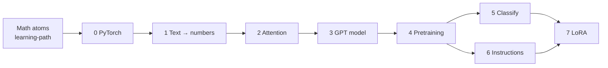

# LLM Learning Path

> **One-liner:** This is the route through Raschka's *Build a Large Language Model (From Scratch)*. It starts from the math you already have in this wiki and ends with a chat model you fine-tuned yourself.

The book builds a GPT-2-style model in three stages ([[llm-building-roadmap]]): build the machine, pretrain it on raw text, then fine-tune it for a job. Each step below lists the pages to read in order. The math each step leans on is shown as "needs".

## Step 0 — The big picture and the tools (Ch. 1, App. A)
- What it is: [[large-language-model]] → [[next-token-prediction]] → [[transformer-architecture]] → [[gpt-architecture]] / [[decoder-only-transformer]] vs [[bert]] and [[encoder-decoder-architecture]]
- How it's made: [[pretraining]] → [[foundation-model]] → [[fine-tuning]] ([[instruction-fine-tuning]], [[classification-fine-tuning]]); [[self-supervised-learning]], [[zero-shot-learning]], [[few-shot-learning]], [[emergent-behavior]]
- The toolkit: [[pytorch]] → [[tensor]] → [[computational-graph]] → [[automatic-differentiation]] → [[pytorch-nn-module]] / [[linear-layer]] → [[pytorch-dataset-and-dataloader]] → [[training-loop]] → [[gpu-computing]] / [[distributed-data-parallel]]
- Needs: [[matrix-multiplication]], [[chain-rule]], [[backpropagation]], [[gradient-descent]], [[multilayer-perceptron]]

## Step 1 — Turning text into numbers (Ch. 2)
- [[tokenization]] → [[vocabulary]] → [[token-id]] → [[special-tokens]] / [[end-of-text-token]] → [[byte-pair-encoding]] / [[subword-tokenization]]
- [[sliding-window-sampling]] with a fixed [[context-length]]
- [[one-hot-encoding]] → [[embedding-layer]] → [[token-embedding]] → [[positional-embedding]] ([[absolute-positional-embedding]], [[relative-positional-embedding]], [[sinusoidal-positional-encoding]]) → [[input-embeddings]]
- Needs: [[vector]], [[vector-space]], [[matrix]], [[linear-mapping]]

## Step 2 — Attention, the heart of the transformer (Ch. 3)
- Why: [[recurrent-neural-network]], [[hidden-state]], [[long-range-dependencies]], [[bahdanau-attention]]
- The core: [[attention-scores]] → [[softmax]] → [[attention-weights]] → [[context-vector]] → [[self-attention]]
- Trainable: [[query-key-value]] → [[scaled-dot-product-attention]]
- No peeking: [[causal-attention]] / [[causal-attention-mask]] + [[dropout]]
- Many heads: [[multi-head-attention]] → [[weight-splitting-multi-head-attention]], [[batched-matrix-multiplication]], [[output-projection]], [[flashattention]]
- Needs: [[inner-product]], [[gram-matrix]], [[convex-combination]], [[numerical-stability]]

## Step 3 — Building the GPT model (Ch. 4)
- [[layer-normalization]] (vs [[batch-normalization]], [[rmsnorm]]) → [[gelu]] / [[relu]] / [[swiglu]] → [[feed-forward-network]] → [[shortcut-connections]] → [[transformer-block]] ([[pre-layernorm-vs-post-layernorm]])
- [[gpt-model-configuration]] → [[gpt-2]] → [[logits]] → [[weight-tying]] → [[parameter-count-and-memory]]
- First text: [[greedy-decoding]] with [[argmax]]
- Needs: [[standardization-z-score]], [[covariance-and-variance]], [[cumulative-distribution-function]], [[vanishing-and-exploding-gradients]]

## Step 4 — Pretraining (Ch. 5, App. D)
- Measuring: [[log-probability]] → [[cross-entropy-loss]] → [[perplexity]] → [[training-and-validation-loss]] on a [[train-validation-test-split]]
- Training: [[llm-training-loop]] with [[adamw-optimizer]] / [[weight-decay]], [[epoch]], [[train-vs-eval-mode]], [[model-checkpointing]], [[pretrained-weights]]
- Generating better text: [[decoding-strategies]] → [[temperature-scaling]] → [[multinomial-sampling]] → [[top-k-sampling]] ([[top-p-sampling]], [[beam-search]])
- Extras: [[learning-rate-warmup]] → [[cosine-decay]] → [[gradient-clipping]] ([[learning-rate-schedule]])
- Needs: [[maximum-likelihood-estimation]], [[probability-distribution]], [[random-variable]]

## Step 5 — Fine-tuning for classification (Ch. 6)
- [[text-classification]] → [[class-imbalance]] → [[transfer-learning]] → [[classification-head]] → [[layer-freezing]] → [[last-token-pooling]] → [[classification-accuracy]] ([[surrogate-loss]])

## Step 6 — Fine-tuning to follow instructions (Ch. 7)
- [[instruction-dataset]] → [[prompt-template]] → [[collate-function]] / [[dynamic-padding]] → [[ignore-index-loss-masking]] / [[instruction-masking]]
- [[response-extraction]] → [[llm-evaluation]] → [[llm-as-a-judge]] ([[local-llm-inference-ollama]])
- What's next: [[preference-fine-tuning]] → [[direct-preference-optimization]]

## Step 7 — Cheap fine-tuning with LoRA (App. E)
- [[parameter-efficient-fine-tuning]] → [[low-rank-adaptation]] → [[lora-rank-and-alpha]]
- Needs: [[low-rank-approximation]], [[basis-and-rank]]

## Connections
- Builds on: [[learning-path]] (the math atoms)
- Leads to: [[mlp-vs-cnn]] (another architecture comparison)
